# VideoMimic Real-to-Sim（真实到仿真）

https://github.com/user-attachments/assets/606049bf-464e-4a16-bc82-9beaaa4fbcc1

[输入：][RGB 视频](https://www.youtube.com/shorts/yvgGak8D4ls)  
[输出：][环境（点云 + 网格）+ 人体 + 机器人](https://www.youtube.com/shorts/ZsqrKNh-eas)

这是 VideoMimic 的视觉处理流程：从单目视频重建三维环境和人体动作，然后将动作重定向到人形机器人。系统从单目视频中提取世界坐标系下的人体姿态，并映射为机器人构型，用于模仿学习。三维环境先重建为点云，之后再生成网格。

## 快速开始

### 📚 文档

- **[安装指南](docs/setup.md)**：安装与环境配置
- **[目录结构](docs/directory.md)**：项目组织、数据下载位置以及输入输出位置
- **[命令指南](docs/commands.md)**：逐步处理命令
- **[多人支持](docs/multihuman.md)**：处理场景中的多个人体
- **[顺序处理](docs/sequential_processing.md)**：按顺序高效处理视频以构建数据集

### 🚀 快速处理流程

```bash
# 准备 `demo_data` 目录
# 从视频提取帧
python utilities/extract_frames_from_video.py --video-path video.MOV --output-dir ./demo_data/input_images/video_name/cam01

# 运行完整流程
./process_video.sh <video_name> <start_frame> <end_frame> <subsample_factor> g1 <height>
# 示例
./process_video.sh my_video 0 100 2 g1 1.8
# height 为 -1 时使用视频自动检测的人体身高（默认值）
# height 为 0 时使用 G1 的体型参数

# 可视化结果
conda activate vm1rs
python visualization/complete_results_egoview_visualization.py \
    --postprocessed-dir ./demo_data/output_calib_mesh/<result_dir> \
    --robot-name g1 --is-megasam
```

## 主要功能

- **单目相机输入：** 支持普通 RGB 视频。
- **三维环境重建：** 从视频恢复稠密的场景几何结构。
- **世界坐标系下的人体动作：** 获取与*经过尺度校准的*环境对齐的人体三维姿态。
- **多人支持：** 可同时跟踪（检测 + 重识别）并重建多个人体。
- **机器人动作重定向：** 支持碰撞感知、接触感知的人体到人形机器人（G1）动作重定向，也支持多种机器人。
- **顺序处理：** 通过复用模型加载结果和 JAX 编译结果，高效构建数据集。

## 流程可视化

<table>
  <tr>
    <td align="center"><br/><b>RGB 输入</b><br/><i>原始视频</i></td>
    <td align="center">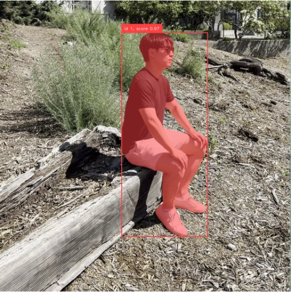<br/><b>SAM2</b><br/><i>人体分割</i></td>
    <td align="center">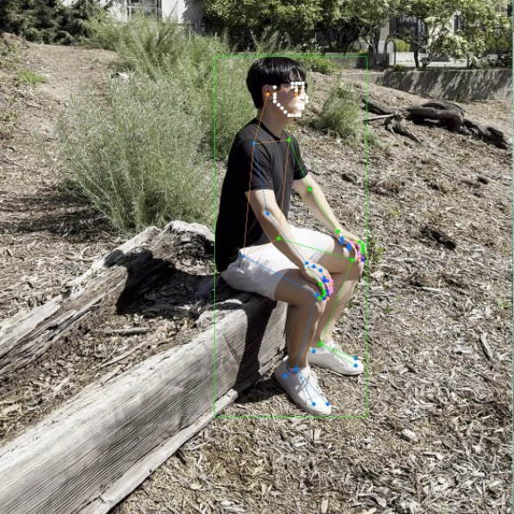<br/><b>ViTPose</b><br/><i>二维姿态估计</i></td>
  </tr>
  <tr>
    <td align="center">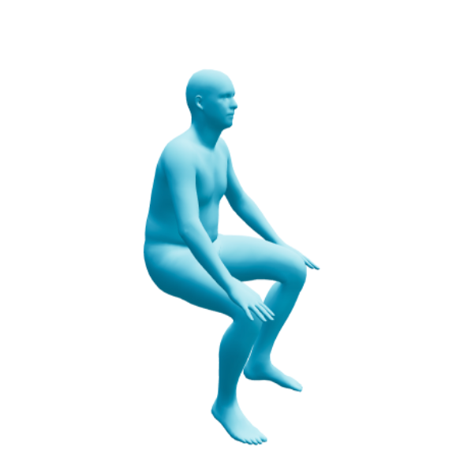<br/><b>VIMO</b><br/><i>三维人体网格</i></td>
    <td align="center">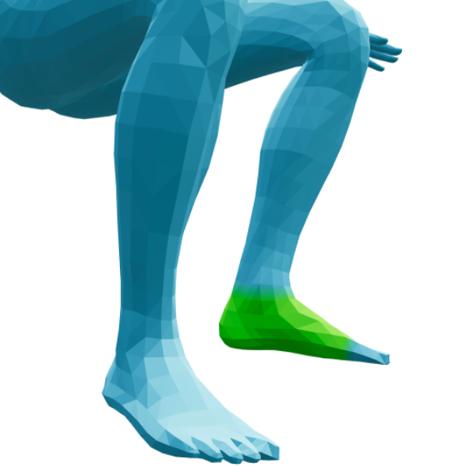<br/><b>BSTRO</b><br/><i>接触检测</i></td>
    <td align="center">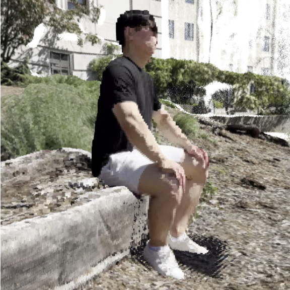<br/><b>MegaSAM</b><br/><i>环境重建</i></td>
  </tr>
  <tr>
    <td align="center">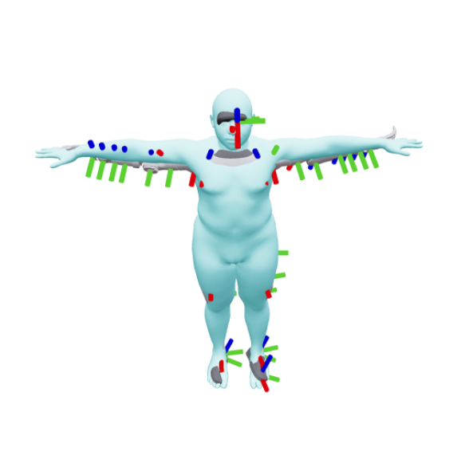<br/><b>形状拟合</b><br/><i>适配 G1</i></td>
    <td align="center">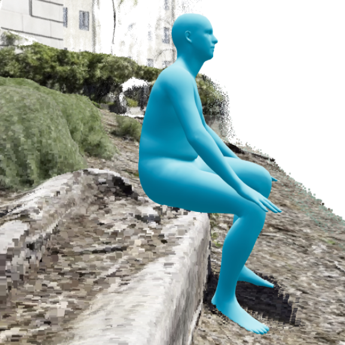<br/><b>MegaHunter</b><br/><i>人体与场景对齐</i></td>
    <td align="center">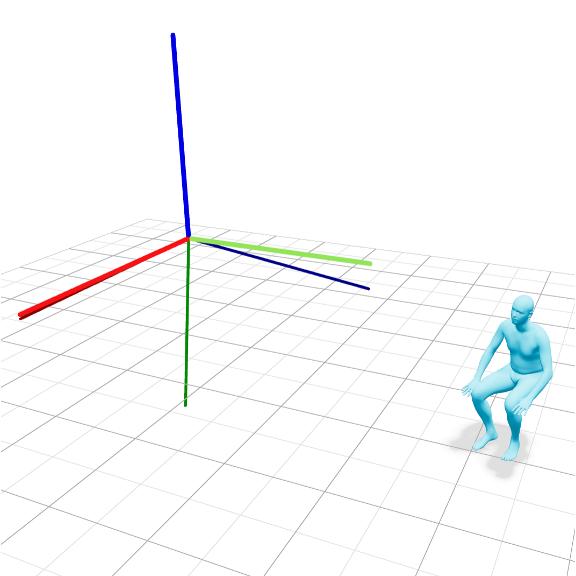<br/><b>GeoCalib</b><br/><i>重力校准</i></td>
  </tr>
  <tr>
    <td align="center">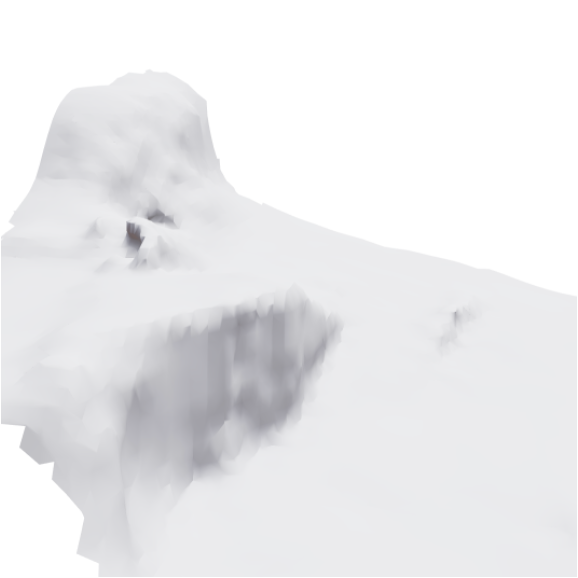<br/><b>NKSR</b><br/><i>点云转网格</i></td>
    <td align="center">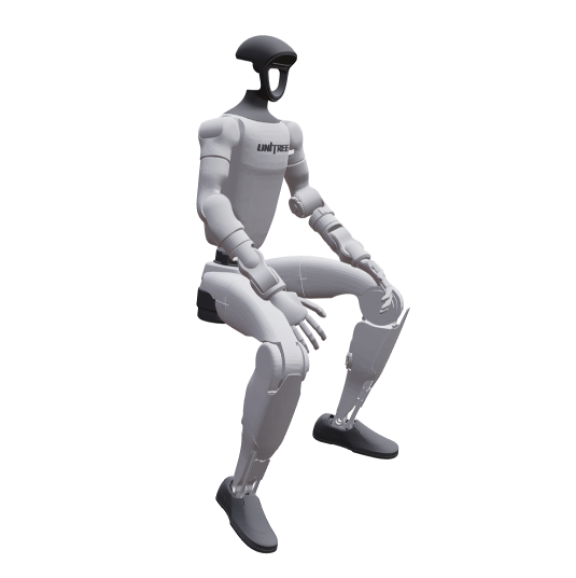<br/><b>PyRoKi</b><br/><i>机器人动作重定向</i></td>
    <td align="center">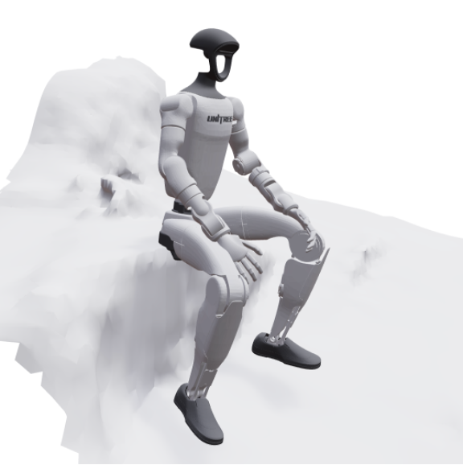<br/><b>可用于仿真的数据集</b><br/><i>环境网格 + 机器人</i></td>
  </tr>
</table>

## 引用

```bibtex
@article{videomimic,
          title     = {Visual imitation enables contextual humanoid control},
          author    = {Allshire, Arthur and Choi, Hongsuk and Zhang, Junyi and McAllister, David
                       and Zhang, Anthony and Kim, Chung Min and Darrell, Trevor and Abbeel,
                       Pieter and Malik, Jitendra and Kanazawa, Angjoo},
          journal   = {arXiv preprint arXiv:2505.03729},
          year      = {2025}
        }
```
